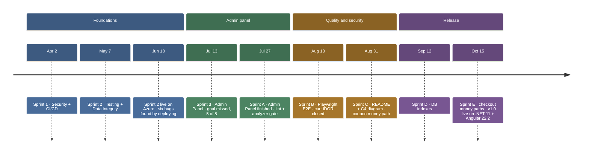

# Progress

Skinet was built in sprints from April to October 2026, and v1.0 went live on Oct 15.
This page is the ledger: one row per sprint, then what went wrong in the planning and what changed.
The day-by-day history (daily log, per-task write-ups, re-baselines) is in
[`docs/archive/progress-history.md`](docs/archive/progress-history.md).

## At a glance

## Sprints

| Sprint | Dates | Goal | Result | Key PRs |
|---|---|---|---|---|
| 1 | → Apr 2 | Security + CI/CD | ✅ 6/6 | — |
| 2 | → May 7 | Testing + data integrity | ✅ 9/9 · first unit tests (128) | — |
| 3 | Jun 16 – Jul 13 | Admin panel | ❌ 5/8 · 12 days over · 3 tasks spilled to A | — |
| A | Jul 14 – Jul 27 | Finish the admin panel | ✅ 5/5 + 2 unplanned bugs | #57, #58, #61 |
| B | Jul 28 – Aug 13 | E2E tests + IDOR fix | ✅ 2/2 + 2 absorbed | #72 |
| C | Aug 12 – Aug 31 | README + demo fixes | 🟡 docs half met · 6 days over · 7 carried | #74–#78 |
| D | Aug 31 – Sep 12 | Demo polish | 🟡 2 shipped in the timebox · rest carried to E | #80 |
| E | Sep 12 – Oct 15 | Demo polish + money paths | ✅ Must 4/4 · Should 3 + 1 partial of 5 | #85–#103 |
| F–H | — | Order domain, hardening | Deferred to v2 when v1.0 was cut to A–E | — |

Per-task tick lists

**Sprint 1 — Security + CI/CD**
- [x] T1 — GitHub Actions: PR trigger, `dotnet test`, `npm ci`
- [x] T3 — Secrets → User Secrets (dev) + Azure Key Vault (prod)
- [x] T4 — Admin seed password → env var / Key Vault
- [x] T5 — Identity password: min 12, upper + number + special
- [x] T6 — Account lockout: 5 attempts, 15 min
- [x] T7 — Cookie: SameSite=Strict, Secure, HttpOnly, 24h

**Sprint 2 — Testing + Data Integrity**
- [x] T9 — CORS explicit + security headers
- [x] T13 — Stock race condition: `[ConcurrencyCheck]` + `DbUpdateConcurrencyException`
- [x] T14 — Transaction: `BeginTransactionAsync()` via `IUnitOfWork`
- [x] T15 — Cart delete after the commit
- [x] T16 — Stripe idempotency key
- [x] T17 — Price change detection: 409 + snackbar + redirect
- [x] T18 — Order idempotency: unique constraint on `PaymentIntentId`
- [x] T19 — Unit tests: Core 90%, Application 89%
- [x] BUG-1 — Checkout address "Next" button stays disabled

**Sprint 3 — Admin Panel**
- [x] T8 — FluentValidation auto-validation
- [x] T24 — Bogus seed: 70 products, 13 users, 25 orders
- [x] T27 — Dashboard backend: `GET /api/admin/dashboard`
- [x] T25 — Admin layout: parent + sidebar + lazy child routes
- [x] T26 — Payment status reconciliation endpoint
- [x] BUG-11 — Checkout 400 for stateless countries
- [x] BUG-12 — Admin orders paginator dead (`pageNumber` → `pageIndex`)
- [x] BUG-13 — Shipping name saved as `"null null"`
- → T28, T29, T30 spilled to Sprint A

**Sprint A — Finish the Admin Panel**
- [x] T54 — ESLint + Prettier + Roslyn analyzers (#57, #58)
- [x] T28 — Dashboard frontend (#61)
- [x] T29 — Admin product list
- [x] T30 — Product create/edit
- [x] T31 — Product delete
- [x] BUG-15 — Product edit served a stale cache
- [x] BUG-16 — Stock edit always 500s (concurrency check on a detached entity)

**Sprint B — E2E Tests + IDOR Fix**
- [x] T37 — Playwright E2E: checkout, auth + orders, admin
- [x] BUG-18 — Cart IDOR: the client chose the cart id (#72)
- [x] T12 — Cart ownership (closed by BUG-18) · T20 — integration harness (absorbed)

**Sprint C — README + Demo Fixes**
- [x] Azure SQL password rotated + firewall audited
- [x] BUG-19 — Coupon validated once, then trusted forever (#75)
- [x] BUG-20 — Every coupon rejected for ~2 months
- [x] Dependency refresh (#74)
- [x] T47 — README (#76)
- [x] T48 — C4 container diagram (#77)
- [x] T52 — Open redirect: reject a non-local `returnUrl` (#78)

**Sprint D — Demo Polish**
- [x] T43 — DB indexes (#80)
- [x] T49 — SQL Server in `docker-compose.yml` (#80)
- [x] BUG-3 — Checkout hint on an empty address field (Oct 14, #94)
- [x] T38 — README screenshot (Oct 14, #99)
- → BUG-10, BUG-14 carried to Sprint E · T33 and the deploy-gate cleanup moved to v2

**Sprint E — Demo Polish + Money Paths**
- [x] BUG-10 — Top loading bar spins forever
- [x] BUG-14 — "Add to cart" disables on click (#85)
- [x] BUG-2 — Declined card can't retry in-session (#86)
- [x] BUG-17 — Logout on `/checkout` lands on `/cart` (#87)
- [x] T58 — Interceptor cleanup (#88)
- [x] T10 — Health-check endpoints (#89)
- [x] T35 — `NgOptimizedImage` on catalogue images (#90)
- [x] T59 — Static-file `Cache-Control` (partial: `index.html` only, #96)
- [x] T61 — Prune unused client deps (#95)
- [x] .NET 11 RC2 + Angular 22.2 (#100, #101) · cart 401 fix (#102) · pinned Docker images (#103)
- [x] v1.0 released Oct 15 · Gate Oct 17–22
- [x] Post-release — UptimeRobot keep-alive, unused Stripe key out of Key Vault (Oct 31, #108)
- [ ] T60 — Scheduled weekly CI advisory run → v2

## Highlights

The work most worth asking about. Each row is one bug or decision.

| What | Why it matters | PR |
|---|---|---|
| **BUG-18 — cart IDOR** | Any signed-in user could read or overwrite any cart by id. The key parameter was removed, so the exploit no longer compiles. | [#72](https://github.com/AlexVieriu/E-commerce_.Net-Angular/pull/72) |
| **BUG-19 — coupon trusted forever** | Three forged-coupon cases proven live, one of them a −$999 order. Order and charge now re-derive the discount from Stripe. | [#75](https://github.com/AlexVieriu/E-commerce_.Net-Angular/pull/75) |
| **BUG-2 — declined card can't retry** | The cart was deleted one step before the charge. It now outlives order creation, and a spent payment intent is replaced. | [#86](https://github.com/AlexVieriu/E-commerce_.Net-Angular/pull/86) |
| **BUG-17 — guard order** | A guard that navigates always beats one that returns. All four guards now return a `UrlTree`. | [#87](https://github.com/AlexVieriu/E-commerce_.Net-Angular/pull/87) |
| **T43 — DB indexes** | Shaped to the real queries, measured on 200k rows: landing page 15,062 → 46 logical reads. | [#80](https://github.com/AlexVieriu/E-commerce_.Net-Angular/pull/80) |
| **T10 — health checks** | Liveness runs no checks, so Azure's probe never wakes the serverless database. Readiness sits behind a key. | [#89](https://github.com/AlexVieriu/E-commerce_.Net-Angular/pull/89) |
| **T35 — image optimization** | Measured, not assumed: the home hero stays a plain ``, `/shop` drops 3440 → 1759 KB, layout shift to 0. | [#90](https://github.com/AlexVieriu/E-commerce_.Net-Angular/pull/90) |
| **T54 — lint + analyzer gate** | 50 → 0 ESLint errors, 368 → 0 Roslyn warnings. It found three real bugs that review had missed. | [#57](https://github.com/AlexVieriu/E-commerce_.Net-Angular/pull/57) |

## Lessons

What the planning got wrong, and what changed. The numbers come from the re-baselines in the archive.

- **Sprints were epics, not timeboxes.** Sprint 3 ran 12 days over because a themed sprint can't end
  until its theme is done. → A sprint ends on its date, and unfinished work moves to the next one.
- **The plan had no room for bugs.** Sprint 3 surfaced three bugs nobody planned for, and Sprint A two more.
  → A Must / Should / Could ladder per sprint, and a half-empty last sprint as a buffer.
- **Estimates were wrong in both directions.** Mechanical work took about half its estimate. Work I had
  to learn took 3–5× (T52: 0.5 days estimated, 2.5 actual). → Estimate by kind, from a measured ledger.
- **Learning had to be capped.** A gate per task grew to a full day each. → One gate day per sprint.
- **Scope, not the date, was the lever that worked.** The date moved three times. v1.0 shipped on Oct 15
  only after Sprints F–H moved to v2.
- **The deploy catches what CI doesn't.** Six bugs in the Sprint 2 deploy, then new security advisories and a
  test host running on real Stripe keys. → A Release build and a live smoke before every release.

## v2 backlog

Order domain (T40, T41), coverage gate (T21), structured logging + correlation IDs (T22, T23), soft delete
(T42), the rest of T59, T60, T33, T63, BUG-21 and BUG-22. Details and estimates are in
[`docs/archive/execution-plan.md`](docs/archive/execution-plan.md).
